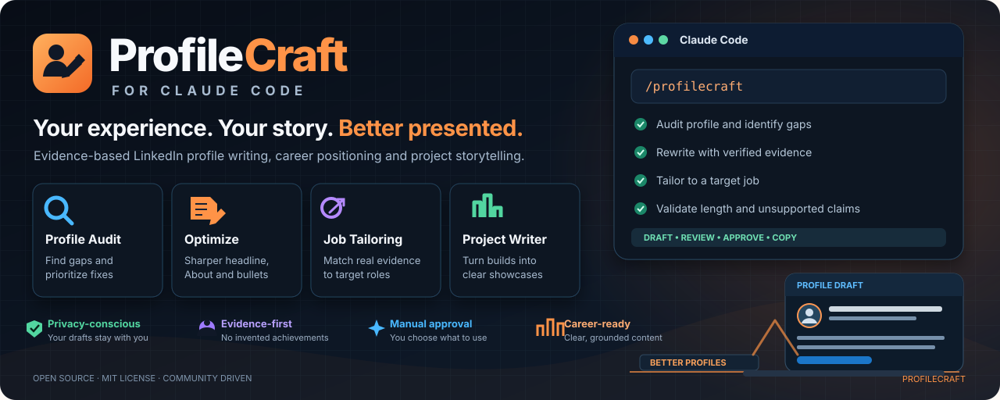

# ProfileCraft for Claude

<p align="center">
  
</p>

**Evidence-based LinkedIn profile writing and audit skills for Claude Code.** Turn your own resume, notes, project documentation and target job descriptions into clear, copy-ready profile content—then review and paste the changes yourself.

[](https://github.com/T-Bone47/profilecraft-claude/actions/workflows/ci.yml) [](LICENSE)

ProfileCraft is community-maintained and is **not affiliated with, endorsed by, or officially listed by LinkedIn or Anthropic**.

## Why ProfileCraft?

- **Evidence-first:** uses facts you provide; unknowns and contradictions become questions rather than invented details.
- **Useful structure:** audits your profile, drafts headlines and About copy, tailors wording to a target role, and turns project evidence into Featured text and resume bullets.
- **Validation included:** a dependency-free Node.js validator checks length, duplicate skills and links, URL validity, contradictory role dates, and unsupported numbers or inflated claims when you provide a facts file.
- **Privacy-aware:** no API key is required by the plugin itself; it does not upload your files to a ProfileCraft service.
- **Manual-first:** you inspect and paste the approved text yourself.

## What it never does

ProfileCraft does not log in to LinkedIn, scrape LinkedIn pages, drive a browser, read cookies, or save changes to your account. It does not bypass security controls or automate profile edits. It never invents titles, dates, metrics, qualifications or skills; if facts are missing or conflict, it asks.

## Included skills

| Skill | Use it to |
| --- | --- |
| `/profilecraft:linkedin-profile-audit` | Audit supplied profile text and prioritize fixes with before/after wording. |
| `/profilecraft:linkedin-profile-optimizer` | Draft a headline, About, experience bullets, skills shortlist and Featured copy; validate the draft. |
| `/profilecraft:linkedin-job-tailor` | Compare verified experience with a job description, separating direct evidence, transferable experience and gaps. |
| `/profilecraft:linkedin-project-writer` | Turn project README/docs/tests into grounded Featured descriptions and resume bullets. |

Fictional sample input and output are available in [`examples/`](examples/). Do not use fictional examples as real career claims.

## Requirements

- Claude Code with plugin support
- Node.js 20 or newer for the optional validator and test suite

The plugin has no npm runtime dependencies and requires no ProfileCraft API key.

## Install from this GitHub marketplace

In an interactive Claude Code session, run:

```text
/plugin marketplace add T-Bone47/profilecraft-claude
/plugin install profilecraft@profilecraft-community
```

Restart or reload the session if Claude Code asks you to. Then invoke a skill by its slash command shown above or describe the task naturally.

## Try locally

Clone the repository and open it in a terminal:

```bash
git clone https://github.com/T-Bone47/profilecraft-claude.git
cd profilecraft-claude
npm test
claude plugin validate .
claude --plugin-dir ./plugins/profilecraft
```

The first two commands run the local checks. `claude plugin validate .` checks the marketplace root using the installed Claude Code CLI; `claude --plugin-dir ...` loads the plugin directly for local testing. Marketplace and live clean-install verification are tracked in the release checklist and CI.

## Use the validator

```bash
node plugins/profilecraft/skills/linkedin-profile-optimizer/validate.mjs examples/draft.example.json examples/profile-input.example.md
```

The validator also accepts `-` as the draft argument to read JSON from standard input. Exit codes: `0` means the draft passed, `1` means validation problems were found, and `2` means invalid input or invocation. It checks the configured character limits, empty values, duplicate skills and links, bad URLs, conflicting current-role dates, and—when a facts file is supplied—unsupported numeric claims or inflated words.

**Limit note:** character limits are configurable constants in `LIMITS`; LinkedIn may change its limits or UI. Verify them against LinkedIn's own current editor before relying on them for a public release.

## Your data and privacy

- Provide only documents and profile text you are comfortable sharing with your own Claude session.
- Keep real drafts, private notes and denylist files in `.profilecraft/`; that directory is ignored by Git.
- Review the proposed copy and each flagged claim before using it publicly.
- Avoid putting personal identifiers, grades, health, finance, immigration or other sensitive information in a public profile unless you specifically intend to disclose it.

ProfileCraft does not transmit your documents to a separate ProfileCraft backend. Your use of Claude is subject to the provider's own product terms and privacy settings.

## Development

```bash
npm test
npm run validate:examples
```

`npm test` uses Node's built-in test runner and no third-party test dependencies. The CI workflow runs on Node.js 20 and 22. The privacy test supports an optional denylist at `.profilecraft/denylist.txt` or `PROFILECRAFT_DENYLIST`; create this file locally with private strings you want checked before a release, and never commit it.

## Contributing

Issues and pull requests are welcome. Read [`CONTRIBUTING.md`](CONTRIBUTING.md), [`CODE_OF_CONDUCT.md`](CODE_OF_CONDUCT.md) and [`SECURITY.md`](SECURITY.md) first. Keep the tests green, use fictional examples, and never add LinkedIn login, scraping, browser automation or security bypasses to the default plugin.

## Project status

This is an early community release. Automated tests cover the local validator, manifest structure and privacy guardrails. Maintainers should verify a clean install with a current Claude Code CLI before creating a tagged release or describing the plugin as marketplace-approved. Inclusion in any Anthropic-curated directory is separate and not guaranteed.

See [`CHANGELOG.md`](CHANGELOG.md) for release notes and [GitHub Actions](https://github.com/T-Bone47/profilecraft-claude/actions) for CI results.
